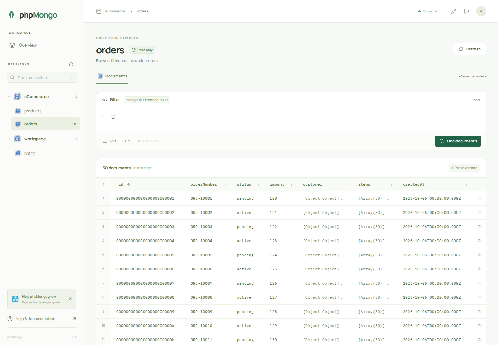
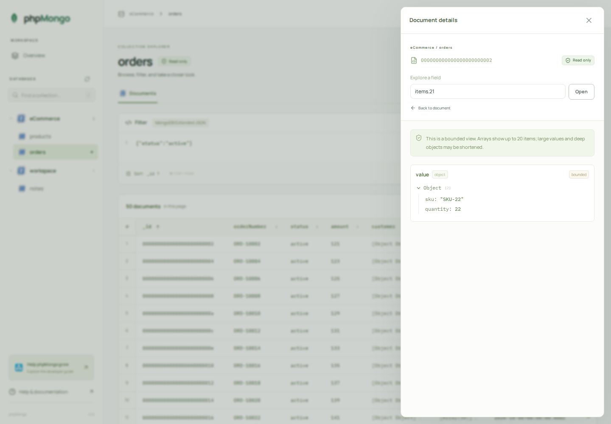

# phpMongo

**Browse, filter, and inspect MongoDB documents from your browser—with a private, read-only PHP dashboard.**

phpMongo gives developers a visual workspace for exploring local or remote MongoDB databases. Unlock the dashboard, connect your database, and start browsing collections. Built with **Slim Framework 4, React, and Tailwind CSS**, it runs on your own machine and ships with its frontend and PHP dependencies ready to use.

[GitHub](https://github.com/phpmongolab/phpmongo) · [Install](#installation) · [Basic usage](#basic-usage) · [Developer docs](#development) · [Contribute](CONTRIBUTING.md) · [MIT license](LICENSE)

## See it in action



Browse collections, filter documents, and inspect typed values in a read-only workspace.



Open a document and explore a specific nested field. Screenshots show the running application with synthetic test data.

## What you can do

- **Explore your databases:** browse databases and collections in the sidebar, or open a collection directly.
- **Find the documents you need:** filter with JSON or MongoDB Extended JSON, sort columns, and paginate results.
- **Inspect complex data:** open individual documents and expand bounded views of nested fields with BSON types preserved.
- **Keep access private:** unlock with a separate master password before entering MongoDB credentials. Local access is the default.
- **Browse read-only:** the application exposes no MongoDB document or schema write operations, even when your database account has write permissions.

The interface includes colourful SVG icons and populated community or sponsor placements on the login screen, sidebar, and this README.

## Installation

### 1. Check the requirements

You need:

- **PHP 8.2+** with JSON, sessions, OpenSSL, and **MongoDB extension 2.5+**.
- A reachable **MongoDB 5.0+** server.
- Write access for PHP to the private `config/` directory during setup and the private runtime storage directory.

Local Apache/Nginx, XAMPP, WampServer, and MAMP are the primary targets. Install the MongoDB extension for the PHP executable your server actually uses. Check it with:

```sh
php --ri mongodb
```

Missing prerequisites display a setup guide. See [the installation guide](INSTALL.md) for extension setup and web-server configuration.

### 2. Extract the release and set your password

Use the **`phpmongo-1.0.0.zip` release package**. The ZIP is built locally; it has not yet been published to [GitHub Releases](https://github.com/phpmongolab/phpmongo/releases). It includes compiled frontend assets and production PHP dependencies; you do not need Node.js or Composer to run it. Native MongoDB extension binaries are installed separately.

Extract the archive and open its `phpmongo-1.0.0/` directory. Copy the configuration template:

```sh
cp config/phpmongo-config.example.php config/phpmongo-config.php
```

On Windows, you can copy and rename the file in Explorer. Edit the copied file and set `security.master_password` to your chosen password. First execution replaces it with a password hash and generates a private encryption key.

### 3. Start phpMongo

From the extracted directory, run:

```sh
php -S 127.0.0.1:8080 -t public public/router.php
```

Open **[http://127.0.0.1:8080](http://127.0.0.1:8080)** in your browser.

For Apache or Nginx, set the document root to **only `public/`**. Keep configuration, dependencies, and runtime storage outside the document root. The [installation guide](INSTALL.md) covers permissions and routing.

## Basic usage

1. **Unlock** the dashboard with your phpMongo master password.
2. **Connect** using a MongoDB URI, such as `mongodb://127.0.0.1:27017`.
3. **Choose a collection** from the sidebar, or enter its database and collection names directly.
4. **Filter** with a JSON object and click **Find documents**. For example:

```json
{"status":"active","amount":{"$gte":100}}
```

To match an ObjectId, use MongoDB Extended JSON:

```json
{"_id":{"$oid":"651c3d82a1b9c8d7e6f5a4b3"}}
```

5. **Inspect a row** to view its document details. Use a field path such as `items.21` to inspect a specific nested value.
6. **Disconnect** to clear the database connection, or **sign out** to end your application session.

MongoDB credentials are encrypted in the server-side session using AES-256-GCM. Sessions expire after one hour of inactivity. Closing or reloading the tab sends a best-effort logout notification.

## Release status and limits

**v1.0.0 is packaged and verified on Linux with PHP 8.3 and MongoDB 7.0.** Verification includes 79 backend checks and 25 browser checks. Windows/macOS package validation remains pending.

The explorer shows 50 documents per page, up to page 200. Preview responses are limited to 1 MiB and details to 2 MiB; large or nested values carry truncation metadata. Queries have a five-second execution limit. Pagination can shift when other clients change the collection.

System databases (`admin`, `local`, and `config`), JavaScript execution, regex filters, and unlisted query operators are blocked. See [the API guide](docs/backend.md) for supported operators, typed identifiers, and expansion limits.

## Development

For a source checkout, install dependencies and build the frontend before following the configuration steps above:

```sh
composer install
npm ci
npm run build
```

Useful commands:

```sh
composer test             # Isolated MongoDB and backend checks
npm run test:browser      # Browser checks against real Slim and MongoDB services
composer docs             # Generate the phpDocumentor API reference
python3 scripts/package-release.py  # Build the release ZIP
python3 scripts/verify-release.py   # Verify and test the extracted package
```

Tests require `mongod`, PHP's curl extension, and an installed Playwright Chromium browser. They start their own temporary MongoDB instance. Packaging also requires Python 3 and Composer.

- [Frontend development and SVG assets](docs/frontend.md)
- [Backend setup and API](docs/backend.md)
- [Version-one scope](docs/v1-scope.md)
- [Architecture decisions](docs/adr/)
- [Domain glossary](GLOSSARY.md)

## Contributing

Bug reports, documentation improvements, and focused pull requests are welcome. Read [CONTRIBUTING.md](CONTRIBUTING.md) for setup, checks, and submission guidance, and follow our [Code of Conduct](CODE_OF_CONDUCT.md).

## Support phpMongo

**Help make MongoDB exploration easier.** Improve the documentation, report reproducible bugs, or contribute to the read-only workspace. Start with the [developer guide](docs/backend.md).

The login, sidebar, and README sponsorship placements stay populated with community calls to action when no paid sponsor is configured. See [sponsorship configuration](docs/frontend.md#sponsorship-and-icons) to configure the dashboard placements.

## License

phpMongo is licensed under the [MIT License](LICENSE). Bundled dependencies and third-party assets retain their respective licenses and provenance, included in the release package.

If phpMongo helps you explore your data, please consider [giving the project a star on GitHub](https://github.com/phpmongolab/phpmongo). Thank you for your support!
